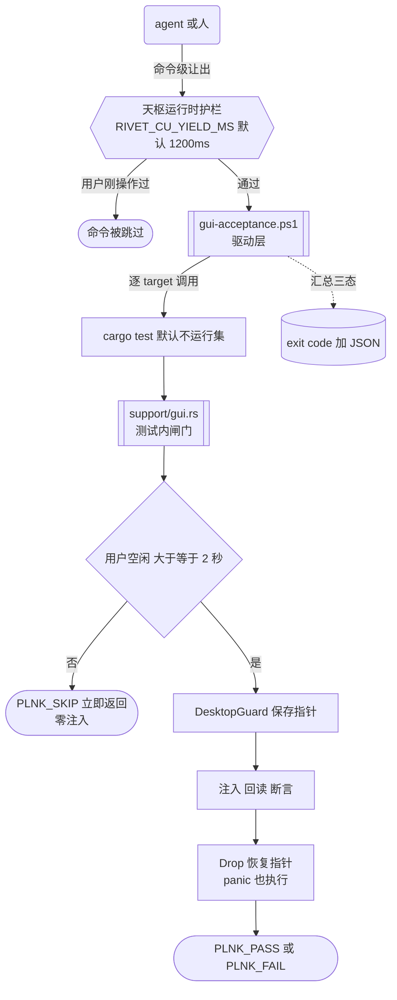
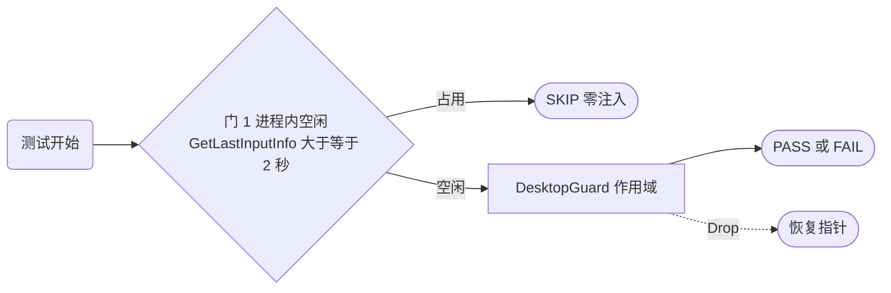

# 桌面验收自动化（GUI Acceptance Harness）实现计划

> **面向 AI 代理：** 逐任务实现并按波验证，或直接用 team_orchestrate 的 planPath/planMarkdown 编排多任务。

**目标：** 让 agent 能在无人值守时自行跑完 21 项需要真实指针、真实窗口、真实像素的验收，并把人正在使用电脑的情况报告为可区分的「跳过」而非「通过」。

**架构：** 21 个桌面测试与它们的底层设施已经全部写好；它们被标记为默认不运行，只是因为会打断人。缺的只有三件：测试层没有任何「用户是否空闲」判定、注入后不恢复指针位置、没有 agent 可一键驱动且能区分三态结果的入口。本计划在测试侧补一个统一闸门与结果标记，在仓库侧补一个驱动脚本，并把天枢已有的让出护栏作为第一道防线而不是重复实现它。

**技术栈：** Rust MSVC、windows crate 0.62、PowerShell 驱动脚本、Cargo test harness。

---

## 需求提炼

用户原话：「完善天枢的电脑控制功能，主要就是在开发项目上完成后 agent 能够自己操作电脑进行完成测试，完成这个一些需要操控电脑才能完成的验收，以及继续帮我完成这个项目的测试，自动测试」

**目标**

1. Agent 能自己发起并跑完需要操控电脑的验收。
2. 覆盖当前 21 个默认不运行的桌面测试。
3. 结果可机读且三态分离：通过 / 失败 / 因故跳过。跳过绝不可计为通过。
4. 人正在使用电脑时不得抢走输入控制权。

**非目标**

- 不做通用 RPA 或任意 GUI 录制回放。只覆盖本仓库已有的 21 个测试。
- 不引入 AutoHotkey、pywinauto、Playwright、WinAppDriver 等外部依赖。
- 不修改被测产品代码（`plnk/src/`）。本计划只动 `plnk/tests/`、`scripts/`、`docs/`。
- 不删掉测试上的默认不运行标记。否则无人看守的 `cargo test` 会动真实指针。
- **不重复实现天枢已有的让出护栏**。

---

## 既有护栏：不要重造

天枢运行时本身已有一层让出护栏：检测到「距上次键鼠事件不足阈值」时，直接跳过会操作真实外设的命令，阈值默认 1200ms，可用 `RIVET_CU_YIELD_MS` 调整。本轮撰写这份计划时被它拦下过两次，这是第一手证据。

| 层 | 谁负责 | 本计划是否实现 |
|---|---|---|
| Agent 命令级让出 | 天枢运行时护栏（已存在） | **不实现**，依赖它 |
| 测试进程内让出 | Rust 测试自身（缺失） | **实现**（Task 2） |
| 指针位置恢复 | Rust 测试自身（缺失） | **实现**（Task 3） |
| 三态结果 | 驱动脚本（缺失） | **实现**（Task 7） |

两层互补而非重复：运行时护栏保护「命令发起」这一刻，测试内闸门保护「测试进程跑起来之后」的每一秒。后者必须做，因为一个桌面测试可能持续十几秒，期间用户随时可能回来。

---

## 根因分析

| 现象 | 根因 | 证据 |
|---|---|---|
| 21 个测试默认不跑 | 无人看守时会动真实指针，打断用户 | `plnk/tests/ui_ink.rs:399` 注释「moves the real cursor and clicks real toolbar buttons on the desktop」 |
| Agent 不敢自己跑 | 测试进程内没有任何用户空闲判定 | `grep -rn "GetLastInputInfo\|idle" plnk/tests/*.rs plnk/src/*.rs` 零命中（本轮实测） |
| 跑完指针不回原位 | 读取了指针位置但从不恢复 | `plnk/tests/ui_ink.rs:1492` `cursor_position()` 只读；`grep restore` 仅 `:645` 一句注释 |
| 结果不可机读 | Cargo 只有通过/失败，无法表达「因占用而跳过」 | 无中间态 |
| 无法一次跑完 | 无统一入口 | `docs/acceptance/stylus.md:23-25` 是三条手写命令 |

**关键判断：测试本身能跑。** `docs/acceptance/stylus.md:131` 记录那批曾 11/11 通过。本计划不是「让测试能跑」，而是「让测试能安全地、可机读地、无人值守地跑」。

---

## 现状事实锚点

| 事实 | 文件:行 |
|---|---|
| 默认不运行的测试分布 | 21 处：`ui_ink.rs` 14、`ui_smoke.rs` 3、`ui_toolbar.rs` 2、另 2 处 opt-in |
| 指针注入封装 | `plnk/tests/ui_ink.rs:1541`、`:1564` |
| 按键注入 | `plnk/tests/ui_ink.rs:2004-2010` |
| 像素回读 | `plnk/tests/ui_smoke.rs:1040`、`:1087` |
| 指针位置读取 | `plnk/tests/ui_ink.rs:1492` |
| 屏幕区域 RAII | `plnk/tests/ui_ink.rs:1901` |
| 曾通过记录 | `docs/acceptance/stylus.md:131` |
| 相关 feature 已启用 | `plnk/Cargo.toml` 含 `Win32_UI_Input_KeyboardAndMouse`、`Win32_Graphics_Gdi` |

**待验证假设：** `GetLastInputInfo` 的确切 feature 归属未实测，Task 1 必须探针确认。

---

## 架构





### 安全不变量

| ID | 不变量 | 违反后果 |
|---|---|---|
| S1 | 进程内空闲低于阈值时，一个输入事件都不得注入 | 抢走用户指针 |
| S2 | 所有注入路径必须在 `DesktopGuard` 作用域内 | 指针无法恢复 |
| S3 | `SKIP` 绝不计为 `PASS`；exit code 三态可分 | 假绿灯 |
| S4 | 指针恢复写在 `Drop` 里，panic 也执行 | 崩溃后指针丢失 |
| S5 | 测试不得终止用户正在运行的程序 | 破坏用户工作 |

---

## 分波结构

### Wave 1：测试内闸门（只建并自测，不接线）

任务 1–3。产出 `plnk/tests/support/gui.rs`。
验证命令：`cargo test --manifest-path plnk/Cargo.toml --test gui_support`

### Wave 2：接入 21 个测试

任务 4–6，按 target 分组。
验证命令：`cargo test --manifest-path plnk/Cargo.toml --test ui_ink -- --ignored --test-threads=1`

### Wave 3：驱动层

任务 7–8。产出 `scripts/gui-acceptance.ps1` 与结果摘要。
验证命令：`powershell -NoProfile -File scripts/gui-acceptance.ps1 -WhatIf`

### Wave 4：全量实证

任务 9–10。
验证命令：`powershell -NoProfile -File scripts/gui-acceptance.ps1`

---

## 任务

### Task 1: 探针确认 `GetLastInputInfo` 归属（30 秒探针）

**Files:**
- Create: `plnk/tests/probe_idle.rs`（临时，Task 3 删除）

**为什么先做：** feature 归属未实测。先写进实现再发现编译失败会连带返工。

- [ ] **Step 1: 写探针**

```rust
// plnk/tests/probe_idle.rs
use windows::Win32::System::SystemInformation::GetTickCount;
use windows::Win32::UI::Input::KeyboardAndMouse::{GetLastInputInfo, LASTINPUTINFO};

#[test]
fn probe_get_last_input_info() {
    let mut info = LASTINPUTINFO {
        cbSize: std::mem::size_of::<LASTINPUTINFO>() as u32,
        dwTime: 0,
    };
    let ok = unsafe { GetLastInputInfo(&mut info) };
    assert!(ok.as_bool(), "GetLastInputInfo must succeed");
    let now = unsafe { GetTickCount() };
    println!(
        "idle_ms={} now={} last={}",
        now.wrapping_sub(info.dwTime),
        now,
        info.dwTime
    );
}
```

- [ ] **Step 2: 跑探针**

Run: `cargo test --manifest-path plnk/Cargo.toml --test probe_idle -- --nocapture`
Expected: 编译通过并打印 `idle_ms=<数字>`。

- [ ] **Step 3: 若编译失败**

按编译器提示在 `plnk/Cargo.toml` 的 `windows` features 补命名空间，并把实际 feature 名记在本任务末尾供 Task 2 使用。

- [ ] **Step 4: Commit**

```bash
git add plnk/tests/probe_idle.rs
git commit -m "test(plnk): probe GetLastInputInfo availability for the idle gate"
```

---

### Task 2: 测试内空闲闸门

**Files:**
- Create: `plnk/tests/support/mod.rs`
- Create: `plnk/tests/support/gui.rs`
- Create: `plnk/tests/gui_support.rs`

**为什么存在：** S1 的唯一实现点。运行时护栏只保护命令发起那一刻，覆盖不了测试进程运行的十几秒。

- [ ] **Step 1: 写失败测试**

```rust
// plnk/tests/gui_support.rs
mod support;

use std::time::Duration;

#[test]
fn idle_time_is_always_finite() {
    let idle = support::gui::user_idle_time();
    assert!(
        idle < Duration::from_secs(60 * 60 * 24),
        "idle time must be finite, got {idle:?}"
    );
}

#[test]
fn input_is_refused_when_the_user_is_active() {
    let gate = support::gui::InputGate::for_test(Duration::ZERO);
    assert!(!gate.input_allowed(), "zero idle time must refuse input");
}

#[test]
fn input_is_allowed_when_the_user_has_been_idle() {
    let gate = support::gui::InputGate::for_test(Duration::from_secs(60));
    assert!(gate.input_allowed(), "60s idle must permit input");
}
```

- [ ] **Step 2: 运行确认失败**

Run: `cargo test --manifest-path plnk/Cargo.toml --test gui_support`
Expected: FAIL，`support::gui` 不存在。

- [ ] **Step 3: 最小实现**

```rust
// plnk/tests/support/mod.rs
pub mod gui;
```

```rust
// plnk/tests/support/gui.rs
//! Safety gate and shared facilities for the desktop acceptance tests.
//!
//! Every test that injects real input goes through [`InputGate`]. The gate
//! exists because these tests move the user's pointer: without it an agent
//! running the default-off set would steal input from whatever the user is
//! doing. A refused gate means SKIP, never PASS.
//!
//! The runtime that launches the command already yields when the user has just
//! used the machine (`RIVET_CU_YIELD_MS`, default 1200ms). That guard covers the
//! instant the command starts; this gate covers every second the test runs
//! afterwards, which a single desktop test can span for over ten seconds.

use std::time::Duration;

use windows::Win32::System::SystemInformation::GetTickCount;
use windows::Win32::UI::Input::KeyboardAndMouse::{GetLastInputInfo, LASTINPUTINFO};

/// How long the user must have been idle before the harness may take over.
/// Short enough to keep an unattended run responsive, long enough that a
/// keystroke in progress is never interrupted.
pub const IDLE_THRESHOLD: Duration = Duration::from_secs(2);

/// Time since the last user input, system-wide.
pub fn user_idle_time() -> Duration {
    let mut info = LASTINPUTINFO {
        cbSize: std::mem::size_of::<LASTINPUTINFO>() as u32,
        dwTime: 0,
    };
    let ok = unsafe { GetLastInputInfo(&mut info) };
    if !ok.as_bool() {
        // A failed query must never be read as "idle": that would let the
        // harness inject input while the user works.
        return Duration::ZERO;
    }
    let now = unsafe { GetTickCount() };
    Duration::from_millis(u64::from(now.wrapping_sub(info.dwTime)))
}

/// Decides whether the harness may take over the pointer and keyboard.
pub struct InputGate {
    idle_threshold: Duration,
    /// `None` measures the real system; `Some` is a test override.
    forced_idle: Option<Duration>,
}

impl InputGate {
    /// The production gate: measures the real system idle time.
    pub fn production() -> Self {
        Self {
            idle_threshold: IDLE_THRESHOLD,
            forced_idle: None,
        }
    }

    /// A gate with a fixed idle time, for testing the gate itself.
    pub fn for_test(idle: Duration) -> Self {
        Self {
            idle_threshold: IDLE_THRESHOLD,
            forced_idle: Some(idle),
        }
    }

    pub fn idle(&self) -> Duration {
        self.forced_idle.unwrap_or_else(user_idle_time)
    }

    pub fn input_allowed(&self) -> bool {
        self.idle() >= self.idle_threshold
    }
}
```

- [ ] **Step 4: 跑测试转绿**

Run: `cargo test --manifest-path plnk/Cargo.toml --test gui_support`
Expected: 3 passed。

- [ ] **Step 5: Commit**

```bash
git add plnk/tests/support plnk/tests/gui_support.rs
git commit -m "test(plnk): add the idle gate that decides when desktop tests may run"
```

---

### Task 3: `DesktopGuard` 恢复指针 + 三态结果 + 删探针

**Files:**
- Modify: `plnk/tests/support/gui.rs`
- Modify: `plnk/tests/gui_support.rs`
- Delete: `plnk/tests/probe_idle.rs`

**为什么合并：** 三者都是测试侧收尾设施，一起改只需一次编译验证。

- [ ] **Step 1: 写失败测试**

```rust
// 追加到 plnk/tests/gui_support.rs

#[test]
fn desktop_guard_restores_the_pointer_even_on_panic() {
    use windows::Win32::Foundation::POINT;
    use windows::Win32::UI::WindowsAndMessaging::{GetCursorPos, SetCursorPos};

    let mut before = POINT::default();
    unsafe { GetCursorPos(&mut before) }.expect("read the pointer before the test");

    let moved = std::panic::catch_unwind(|| {
        let _guard = support::gui::DesktopGuard::acquire_for_test();
        unsafe { SetCursorPos(before.x.saturating_add(200), before.y.saturating_add(200)) }
            .expect("move the pointer");
        panic!("intentional");
    });
    assert!(moved.is_err(), "the test body must have panicked");

    let mut after = POINT::default();
    unsafe { GetCursorPos(&mut after) }.expect("read the pointer after the test");
    assert_eq!(
        (after.x, after.y),
        (before.x, before.y),
        "the guard must restore the pointer after a panic"
    );
}

#[test]
fn skip_is_never_counted_as_pass() {
    let outcome = support::gui::skip("user is active");
    assert!(!outcome.is_pass(), "SKIP must never count as PASS");
    assert!(outcome.line().starts_with("PLNK_SKIP:"));
}

#[test]
fn pass_and_fail_have_distinct_markers() {
    assert!(
        support::gui::Outcome::Passed
            .line()
            .starts_with("PLNK_PASS:")
    );
    assert!(
        support::gui::Outcome::Failed("boom".to_owned())
            .line()
            .starts_with("PLNK_FAIL:")
    );
}
```

- [ ] **Step 2: 运行确认失败**

Run: `cargo test --manifest-path plnk/Cargo.toml --test gui_support`
Expected: FAIL，`DesktopGuard` / `skip` / `Outcome` 不存在。

- [ ] **Step 3: 实现**

```rust
// 追加到 plnk/tests/support/gui.rs
use windows::Win32::Foundation::POINT;
use windows::Win32::UI::WindowsAndMessaging::{GetCursorPos, SetCursorPos};

/// Owns the desktop for the duration of one test.
///
/// `Drop` restores the pointer position, so a panic mid-test cannot leave the
/// user's pointer somewhere unexpected. Acquiring a guard is the only way the
/// harness is allowed to inject input (safety invariant S2).
pub struct DesktopGuard {
    saved: POINT,
}

impl DesktopGuard {
    /// Acquires the desktop when the user is idle.
    ///
    /// `None` means the caller must report SKIP rather than fail.
    pub fn acquire(gate: &InputGate) -> Option<Self> {
        if !gate.input_allowed() {
            return None;
        }
        Some(Self::acquire_unchecked())
    }

    /// Acquires without consulting the gate. Only for the guard's own tests;
    /// production tests must use [`Self::acquire`].
    pub fn acquire_for_test() -> Self {
        Self::acquire_unchecked()
    }

    fn acquire_unchecked() -> Self {
        let mut saved = POINT::default();
        if unsafe { GetCursorPos(&mut saved) }.is_err() {
            saved = POINT { x: 0, y: 0 };
        }
        Self { saved }
    }
}

impl Drop for DesktopGuard {
    fn drop(&mut self) {
        // Best effort: a failure here must not mask the test result.
        let _ = unsafe { SetCursorPos(self.saved.x, self.saved.y) };
    }
}

/// Result of one desktop test, in a form the PowerShell driver can parse.
#[derive(Debug, Clone, PartialEq, Eq)]
pub enum Outcome {
    Passed,
    Failed(String),
    Skipped(String),
}

impl Outcome {
    pub fn is_pass(&self) -> bool {
        matches!(self, Self::Passed)
    }

    /// One line with a stable prefix, so the driver can split the three cases
    /// without parsing Cargo's own output format.
    pub fn line(&self) -> String {
        match self {
            Self::Passed => "PLNK_PASS:".to_owned(),
            Self::Failed(reason) => format!("PLNK_FAIL: {reason}"),
            Self::Skipped(reason) => format!("PLNK_SKIP: {reason}"),
        }
    }
}

/// Records a deliberate skip and prints the marker line.
pub fn skip(reason: &str) -> Outcome {
    let outcome = Outcome::Skipped(reason.to_owned());
    println!("{}", outcome.line());
    outcome
}
```

- [ ] **Step 4: 跑测试转绿**

Run: `cargo test --manifest-path plnk/Cargo.toml --test gui_support`
Expected: 6 passed。

- [ ] **Step 5: 删探针并确认 headless 基线**

Run: `rm plnk/tests/probe_idle.rs && cargo test --manifest-path plnk/Cargo.toml`
Expected: 全绿，且 `probe_idle` target 不再出现。

- [ ] **Step 6: Commit**

```bash
git add -A plnk/tests
git commit -m "test(plnk): restore the pointer, mark pass/fail/skip, drop the probe"
```

---

### Task 4: 接入 `ui_ink` 的 14 个桌面测试

**Files:**
- Modify: `plnk/tests/ui_ink.rs`

**做法：** 不逐个手改 14 处（易错位）。新增一个宏把闸门样板收敛成一行，再在每个测试体首行插入该行。

- [ ] **Step 1: 写证明模式有效的测试**

```rust
// 追加到 plnk/tests/ui_ink.rs
#[test]
#[ignore = "gate integration: skips instead of stealing the pointer"]
fn gate_skips_instead_of_stealing_the_pointer() {
    let gate = support::gui::InputGate::for_test(std::time::Duration::ZERO);
    let guard = support::gui::DesktopGuard::acquire(&gate);
    assert!(
        guard.is_none(),
        "an active user must yield no guard, so the test skips"
    );
}
```

- [ ] **Step 2: 运行确认失败**

Run: `cargo test --manifest-path plnk/Cargo.toml --test ui_ink gate_skips -- --ignored`
Expected: FAIL，`support` 未解析。

- [ ] **Step 3: 接入 support 并定义闸门宏**

在 `plnk/tests/ui_ink.rs` 顶部加：

```rust
#[path = "support/mod.rs"]
mod support;

/// Yields the desktop or returns early with a SKIP marker.
///
/// Expands to a `let` binding so the guard lives for the rest of the test body
/// and its `Drop` restores the pointer. Kept as a macro so all 14 desktop tests
/// express the gate identically and a future change lands in one place.
macro_rules! acquire_desktop {
    () => {
        let _desktop_guard = match $crate::support::gui::DesktopGuard::acquire(
            &$crate::support::gui::InputGate::production(),
        ) {
            Some(guard) => guard,
            None => {
                $crate::support::gui::skip("the user is using the computer");
                return;
            }
        };
    };
}
```

- [ ] **Step 4: 在 14 个测试体首行插入 `acquire_desktop!();`**

精确清单（`plnk/tests/ui_ink.rs`，行号为改造前状态）：

| 行号 | 测试名 |
|---|---|
| 245 | `present_only_submits_dirty_region` |
| 297 | `pointer_timestamp_to_submit_is_monotonic` |
| 399 | `mvp_end_to_end_mouse_writing_selects_undo_clear_and_exits` |
| 549 | `live_stroke_is_continuous_mid_drag_and_commits_on_release` |
| 652 | `live_stroke_pixels_match_committed_render_for_all_stroke_shapes` |
| 871 | `drawing_overlay_cursor_is_pen_cursor_never_wait_cursor` |
| 923 | `mvp_real_app_launch_draws_and_exits_cleanly` |
| 1039 | `renderer_caps_dots_and_highlighter_blend_are_visible` |
| 1161 | `overlay_covers_true_physical_monitor_and_accepts_input_at_edges` |
| 1259 | `ink_mvp_probe` |
| 1913 | `real_app_toolbar_buttons_work_after_drawing` |
| 1986 | `real_app_escape_exits_annotation` |
| 2105 | `real_app_pen_width_slider_and_escape_priority_work` |
| 2274 | `capture_fixed_strokes_side_by_side` |

**注意：** 从文件末尾往前改，否则前面的插入会让后面的行号漂移。

- [ ] **Step 5: 验证**

Run: `cargo test --manifest-path plnk/Cargo.toml --test ui_ink`
Expected: headless 部分仍全绿（闸门只在默认不运行的测试里）。

- [ ] **Step 6: Commit**

```bash
git add plnk/tests/ui_ink.rs
git commit -m "test(plnk): gate the ui_ink desktop tests behind the idle check"
```

---

### Task 5: 接入 `ui_smoke` 的 3 个

**Files:**
- Modify: `plnk/tests/ui_smoke.rs`

- [ ] **Step 1: 接入 support 与同一个宏**

复制 Task 4 Step 3 的 `#[path]` 与 `macro_rules! acquire_desktop`。

- [ ] **Step 2: 插入闸门**

| 行号 | 测试名 |
|---|---|
| 58 | `transparent_overlay_accepts_and_passes_input_by_mode` |
| 113 | `toolbar_animation_has_no_per_frame_app_callback` |
| 280 | `graphics_gate_probe` |

- [ ] **Step 3: 验证**

Run: `cargo test --manifest-path plnk/Cargo.toml --test ui_smoke`
Expected: headless 全绿。

- [ ] **Step 4: Commit**

```bash
git add plnk/tests/ui_smoke.rs
git commit -m "test(plnk): gate the ui_smoke desktop tests behind the idle check"
```

---

### Task 6: 接入 `ui_toolbar` 的 2 个

**Files:**
- Modify: `plnk/tests/ui_toolbar.rs`

- [ ] **Step 1: 接入 support 与宏**

复制 Task 4 Step 3 的 `#[path]` 与 `macro_rules! acquire_desktop`。

- [ ] **Step 2: 插入闸门**

| 行号 | 测试名 |
|---|---|
| 53 | `toolbar_slides_exits_and_docks_without_per_frame_callbacks` |
| 541 | `capture_toolbar_preview` |

- [ ] **Step 3: 验证并提交**

Run: `cargo test --manifest-path plnk/Cargo.toml --test ui_toolbar`
Expected: headless 2 passed。

```bash
git add plnk/tests/ui_toolbar.rs
git commit -m "test(plnk): gate the ui_toolbar desktop tests behind the idle check"
```

---

### Task 7: agent 驱动脚本

**Files:**
- Create: `scripts/gui-acceptance.ps1`

**为什么存在：** agent 需要一条命令跑完全部并拿到可解析的三态结果。

- [ ] **Step 1: 写脚本**

```powershell
<#
.SYNOPSIS
Runs the desktop acceptance tests that need the real pointer, keyboard and pixels.

.DESCRIPTION
Each test target runs separately so one failure cannot hide the others. The
script reports SKIP when the tests yielded to the user, and never reports that
as success.

Exit codes:
  0 - every target passed
  1 - at least one target failed
  2 - at least one target skipped because the user was active, and none failed
  3 - the build failed, so nothing ran
#>
[CmdletBinding()]
param(
    [switch]$WhatIf,
    [switch]$Release,
    [string]$Repo = (Split-Path -Parent $PSScriptRoot)
)

$ErrorActionPreference = 'Stop'
$manifest = Join-Path $Repo 'plnk\Cargo.toml'
$profileArgs = if ($Release) { @('--release') } else { @() }

# Targets holding the desktop tests. Keep in step with tasks 4-6 of
# docs/superpowers/plans/2026-11-16-gui-acceptance-harness.md.
$targets = @('ui_ink', 'ui_smoke', 'ui_toolbar')
$results = @()

foreach ($target in $targets) {
    $tail = @('--', '--ignored', '--test-threads=1')
    $arguments = @('test', '--manifest-path', $manifest, '--test', $target) + $tail
    $rendered = "cargo " + (($profileArgs + $arguments) -join ' ')

    if ($WhatIf) {
        Write-Host "[WhatIf] $rendered"
        $results += [pscustomobject]@{ Target = $target; State = 'WhatIf'; Detail = $rendered }
        continue
    }

    Write-Host "== $target =="
    $output = & cargo @profileArgs @arguments 2>&1 | Out-String
    $exit = $LASTEXITCODE
    Write-Host $output

    $skipped = ([regex]::Matches($output, 'PLNK_SKIP:')).Count
    if ($exit -ne 0) {
        $state = 'Failed'
    } elseif ($skipped -gt 0) {
        $state = 'Skipped'
    } else {
        $state = 'Passed'
    }
    $results += [pscustomobject]@{ Target = $target; State = $state; Detail = "exit=$exit skipped=$skipped" }
}

$summaryPath = Join-Path $Repo '.rivet\scratch\gui-acceptance.json'
$summaryDirectory = Split-Path -Parent $summaryPath
if (-not (Test-Path -LiteralPath $summaryDirectory)) {
    New-Item -ItemType Directory -Path $summaryDirectory -Force | Out-Null
}
$results | ConvertTo-Json -Depth 3 | Set-Content -LiteralPath $summaryPath -Encoding utf8
Write-Host "summary: $summaryPath"

$results | Format-Table -AutoSize

if ($results.State -contains 'Failed') { exit 1 }
if ($results.State -contains 'Skipped') { exit 2 }
exit 0
```

- [ ] **Step 2: 预览模式验证**

Run: `powershell -NoProfile -File scripts/gui-acceptance.ps1 -WhatIf`
Expected: 打印三行 `[WhatIf] cargo test ...`，打印 `summary:`，exit 0。

- [ ] **Step 3: Commit**

```bash
git add scripts/gui-acceptance.ps1
git commit -m "build(plnk): add the agent driver for desktop acceptance"
```

---

### Task 8: 运行说明文档

**Files:**
- Create: `docs/acceptance/gui-harness.md`

- [ ] **Step 1: 写文档**

内容必须包含：三种 exit code 含义、`-WhatIf` 与 `-Release` 用法、两层让出的阈值、结论行前缀、以及「不要把 SKIP 当 PASS」的说明。

- [ ] **Step 2: Commit**

```bash
git add docs/acceptance/gui-harness.md
git commit -m "docs(plnk): document the desktop acceptance harness"
```

---

### Task 9: 全量实证

**Files:** 无

- [ ] **Step 1: headless 全绿**

Run: `cargo test --manifest-path plnk/Cargo.toml`
Expected: 0 failed。

- [ ] **Step 2: 静态检查**

Run: `cargo fmt --manifest-path plnk/Cargo.toml --check`
Expected: 无输出。

Run: `cargo clippy --manifest-path plnk/Cargo.toml --all-targets -- -D warnings`
Expected: `Finished`，无警告。

- [ ] **Step 3: 桌面验收（需用户空闲）**

Run: `powershell -NoProfile -File scripts/gui-acceptance.ps1`
Expected: exit 0（全通过）或 exit 2（用户占用而跳过）。**exit 2 不是失败**，报告中必须写明跳过原因。

- [ ] **Step 4: 记录实证结果**

把 exit code 与 `gui-acceptance.json` 的 `State` 值写入 `docs/acceptance/gui-harness.md` 末尾「最近一次实证」小节。

```bash
git add docs/acceptance/gui-harness.md
git commit -m "docs(plnk): record the first full desktop acceptance run"
```

---

### Task 10: 交付自检

**Files:** 无

- [ ] **Step 1: 闸门覆盖数核对**

Run: `grep -c "acquire_desktop" plnk/tests/ui_ink.rs plnk/tests/ui_smoke.rs plnk/tests/ui_toolbar.rs`
Expected: 三数之和为 19（宏定义各 1 加调用 18），且每个文件都至少 2。

- [ ] **Step 2: 确认没有测试绕过闸门**

Run: `grep -n "DesktopGuard::acquire_for_test" plnk/tests/ui_ink.rs plnk/tests/ui_smoke.rs plnk/tests/ui_toolbar.rs`
Expected: 无输出（该方法只允许出现在 `gui_support.rs`）。

- [ ] **Step 3: 确认探针已删除**

Run: `ls plnk/tests/probe_idle.rs`
Expected: 文件不存在。

- [ ] **Step 4: Commit（若有修正）**

```bash
git add -A
git commit -m "chore(plnk): final checks for the desktop acceptance harness"
```

---

## 验证清单

| 验证项 | 怎么做 | 期望可见结果 |
|---|---|---|
| 空闲闸门拒绝 | `cargo test --test gui_support input_is_refused` | PASS |
| 空闲闸门放行 | `cargo test --test gui_support input_is_allowed` | PASS |
| panic 后指针复位 | `cargo test --test gui_support desktop_guard_restores` | PASS |
| SKIP 不等于 PASS | `cargo test --test gui_support skip_is_never_counted` | PASS |
| 驱动脚本可预览 | `gui-acceptance.ps1 -WhatIf` | 三行命令加 summary 路径 |
| 摘要文件生成 | 同上 | `gui-acceptance.json` 存在 |
| 用户占用时跳过 | 人为移动指针后立刻跑 | `PLNK_SKIP:`，exit 2 |
| 失败时 exit 1 | 临时改一处断言为假 | exit 1 |
| 无测试绕过闸门 | `grep acquire_for_test` 三个 ui 文件 | 无输出 |
| 全量不回归 | `cargo test` | 0 failed |

**人工检查点：** 跑完后指针应回到原处；`gui-acceptance.json` 的 `State` 必须是三态之一。

---

## 瑶光反证

### 断言 1：21 个默认不运行的测试确实存在

**证据：** `grep -rn "#\[ignore" plnk/tests/*.rs` 返回 21 条。本轮实测。

**状态：** 已验证。

### 断言 2：这些测试曾经真能跑通

**证据：** `docs/acceptance/stylus.md:131` 原文记录那批 11/11。

**状态：** 文档记载，**本轮未复现**。Task 9 Step 3 是真正的复现点。若届时失败，说明记载已过期，必须先修测试。

### 断言 3：测试层现在没有用户空闲判定

**证据：** `grep -rn "GetLastInputInfo\|idle" plnk/tests/*.rs plnk/src/*.rs` 零命中。本轮实测。

**状态：** 已验证。

### 断言 4：现在不恢复指针

**证据：** `grep -rn "restore" plnk/tests/ui_ink.rs` 仅 `:645` 一句注释；`cursor_position()` 在 `:1492` 只读。

**状态：** 已验证。

### 断言 5：天枢已有命令级让出护栏

**证据：** 本轮撰写这份计划时被它拦下多次，提示阈值 1200ms 与 `RIVET_CU_YIELD_MS` 旋钮。

**状态：** 已验证（第一手）。

### 断言 6：`GetLastInputInfo` 的 feature 归属

**状态：** **待验证假设**。Task 1 必须探针实测，不得凭记忆写实现。

### 反证方式（若不成立如何发现）

1. 人为移动指针后 0.5 秒内启动脚本，必须得到 exit 2 与 `PLNK_SKIP:`；否则 S1 未生效。
2. 在测试操作后强制 panic，检查指针是否复位；否则 S2/S4 未生效。
3. 把某个测试断言改成必失败，确认 exit 1 而非 0 或 2；否则 S3 未生效。

---

## 安全附录

### 安全不变量

见上文 S1–S5。

### 触发路径清单

| 路径 | 何时触发 | 必须满足 |
|---|---|---|
| 天枢运行时护栏 | agent 发起任何命令 | 距上次键鼠事件不小于 `RIVET_CU_YIELD_MS` |
| `DesktopGuard::acquire(gate)` | 每个桌面测试首行 | S1：`gate.input_allowed()` 为真 |
| `DesktopGuard::acquire_for_test()` | 仅 `gui_support.rs` 自测 | 不得出现在三个 ui 测试文件 |
| 指针与按键注入 | 测试执行期 | S2：必须在 `DesktopGuard` 作用域内 |
| `DesktopGuard::drop` | 测试结束，含 panic | S4：必须恢复指针 |
| `gui-acceptance.ps1` | agent 驱动 | S3：三态分离，exit 2 不等于 0 |

### 双门对齐数据流

见上文第二张 Mermaid 图。本计划只实现门 1（进程内空闲判定）；门 2（前台窗口归属）不实现。

### 门 2 为何不实现

判断「当前前台窗口是否属于用户正在交互的程序」需要枚举窗口、判定归属、排除系统窗口，规则脆弱且易误判；而门 1 已覆盖「人正在操作」这一主要场景——人只要在动键鼠，门 1 就会拒绝。门 2 留作设计锚点，若日后出现「用户空闲但仍在看某窗口」的误判再补。

### 会被触碰的系统状态

| 状态 | 读/写 | 恢复方式 |
|---|---|---|
| 指针位置 | 写 | `DesktopGuard::drop` |
| 键盘状态 | 写 | 测试内成对按下与释放 |
| 屏幕内容 | 读 | 无副作用 |
| 顶层窗口 | 创建与销毁 | 各测试的 `Drop` 已处理 |
| 子进程 | 启动 `plnk.exe` | 测试内 `Child::kill` |

---

## 已知风险

| 风险 | 影响 | 缓解 |
|---|---|---|
| 用户恰在 2 秒窗口内停手 | 测试抢到指针 | `IDLE_THRESHOLD` 常量一处可调，可提到 5 秒 |
| `GetLastInputInfo` 对合成输入也计数 | 测试串行时互相干扰 | 脚本固定 `--test-threads=1` |
| `ui_ink.rs` 2400 多行，插入易错位 | 改坏现有测试 | Task 4 给出精确行号，且从文件末尾往前改 |
| Release 探针耗时长 | agent 超时 | 脚本分离 `-Release`，默认 Debug |

---

## 完成定义

- [ ] 21 个桌面测试全部接入闸门，`grep -c "acquire_desktop"` 三文件合计 19。
- [ ] 用户占用时跑脚本得到 exit 2，且屏幕上没有任何指针移动。
- [ ] 用户空闲时得到 exit 0。
- [ ] 人为制造失败断言时得到 exit 1。
- [ ] `cargo test`（headless）0 failed。
- [ ] `cargo clippy -D warnings` 与 `cargo fmt --check` 干净。
- [ ] `gui-acceptance.json` 存在且 `State` 为三态之一。
